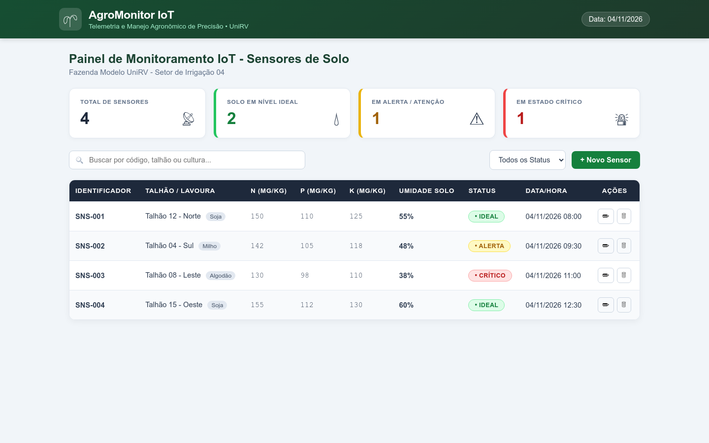

# AgroMonitor IoT — Painel de Monitoramento Agrícola (agro-sensor-web)

Projeto desenvolvido para a disciplina de **Prática de Laboratório — Desenvolvimento Web** da **UniRV (Universidade de Rio Verde)**, ministrada pelo **Prof. Me. Sergio Souza Novak**.

---

## 👤 Identificação do Aluno

* **Nome:** Maria Eduarda Costa Tolêdo
* **Matrícula UniRV:** `24107SFT067`
* **Curso:** Engenharia de Software / Ciência da Computação
* **Instituição:** Universidade de Rio Verde (UniRV)

---

## 🎯 Sobre o Projeto

Aplicação web desenvolvida em **Angular** com **TypeScript** para monitoramento agrícola de precisão (IoT), exibindo métricas físico-químicas de solo (Nitrogênio, Fósforo, Potássio, Umidade e Status Operacional) com dados de teste. O painel permite buscar, filtrar, cadastrar, editar e excluir sensores durante a sessão.

### Principais Tecnologias e Conceitos Aplicados:
* **SPA (Single Page Application)** com Angular moderno;
* **TypeScript:** Interfaces e tipagem estática de dados (`LeituraSolo`);
* **Angular CLI:** Criação e modularização da estrutura;
* **Arquitetura de Componentes:** Componente dedicado `container-tabela`;
* **Data Binding:** Interpolação (`{{ }}`) e diretivas estruturais (`*ngFor`);
* **CSS Customizado:** Efeito zebra, cabeçalho contrastante e distintivos visuais (badges) para os status (*Ideal*, *Alerta* e *Crítico*).

---

## 📸 Captura de Tela (Resultado em Execução)

Abaixo está a captura de tela da tabela de sensores renderizada no navegador em `http://localhost:4200`:



---

## 🚀 Instruções de Instalação e Execução

### Pré-requisitos
* **Node.js** (`^22.22.3`, `^24.15.0` ou `>=26.0.0`)
* **npm**
* **Angular CLI** instalado globalmente (`npm install -g @angular/cli@22`)

### 1. Clonar o repositório
```bash
git clone https://github.com/MariaEduardaCos/agro-sensor.git agro-sensor-web
cd agro-sensor-web
```

### 2. Instalar dependências
```bash
npm install
```

### 3. Iniciar o servidor local de desenvolvimento
```bash
ng serve
```

Após iniciar, abra o navegador e acesse:
```
http://localhost:4200
```

---

## 📁 Estrutura de Arquivos Relevantes

```text
agro-sensor-web/
├── docs/
│   └── screenshot.png                     # Captura da tela da aplicação
├── src/
│   ├── app/
│   │   ├── interfaces/
│   │   │   └── sensores.interface.ts      # Interface LeituraSolo (Tipagem)
│   │   ├── container-tabela/
│   │   │   ├── container-tabela.component.ts    # Lógica e mock de dados
│   │   │   ├── container-tabela.component.html  # Template com tabela e *ngFor
│   │   │   └── container-tabela.component.css   # Estilização, zebra e badges
│   │   ├── app.component.ts               # Componente raiz Standalone
│   │   └── app.component.html             # Integração do seletor
│   ├── styles.css                         # Estilos globais
│   └── main.ts                            # Bootstrap da aplicação
├── .gitignore                             # Ignora node_modules/ e dist/
├── README.md                              # Documentação e identificação
└── package.json                           # Dependências e scripts
```
